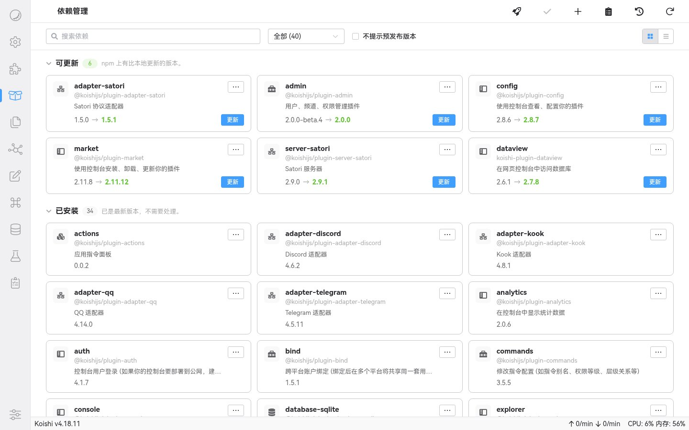
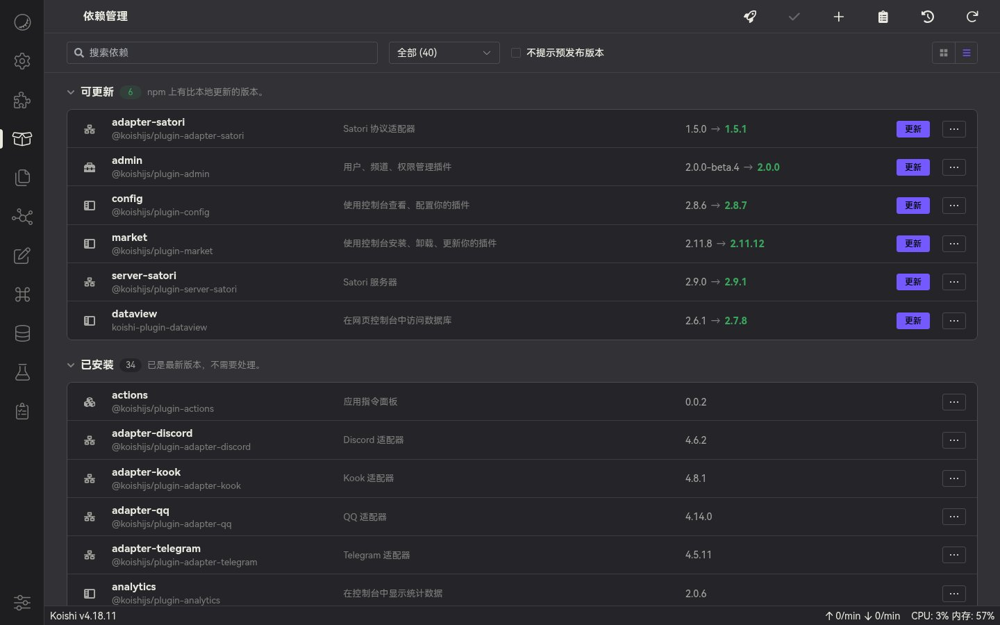
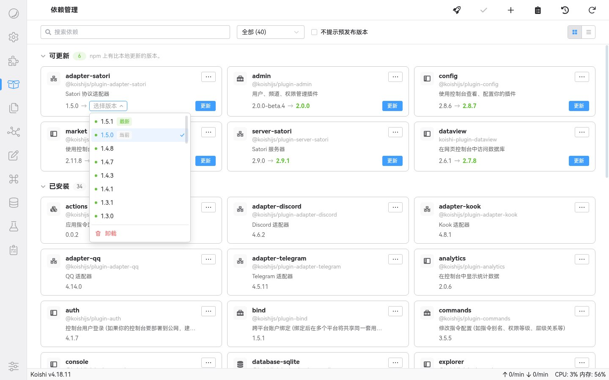
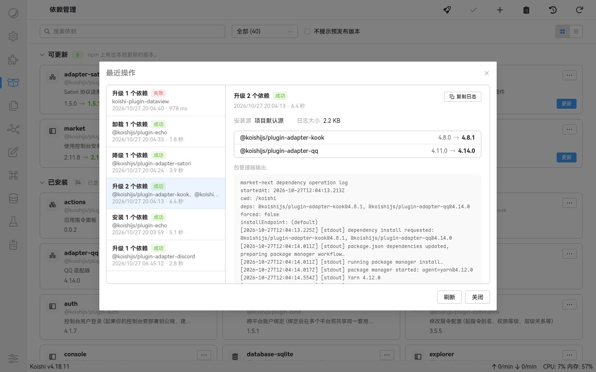
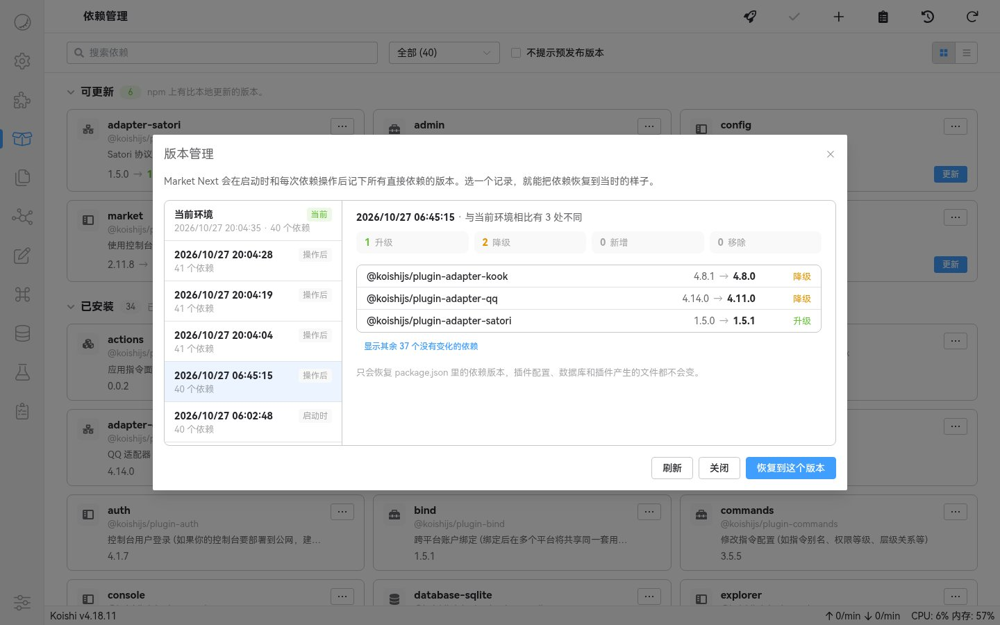
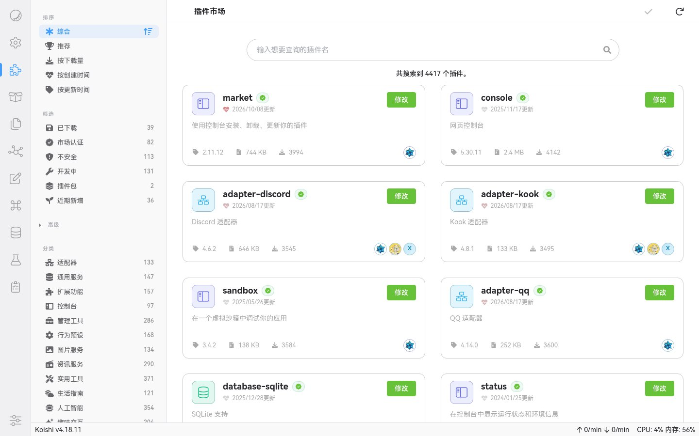
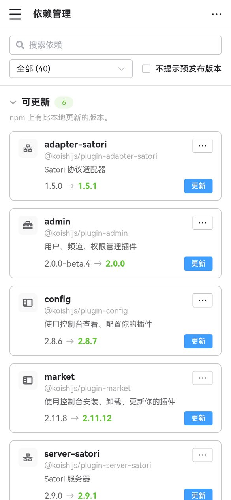

<div align="center">

# Market Next

[](https://www.npmjs.com/package/koishi-plugin-market-next)
[](https://github.com/qinfeng365/koishi-plugin-market-next/actions/workflows/ci.yml)
[](https://koishi.chat)
[](./LICENSE)

**更好用的 Koishi 插件市场与依赖管理**

用来替代 Koishi 自带的插件市场（`@koishijs/plugin-market`）。<br>
市场打开更快、弱网下更稳；装插件前看得清会改动什么，出了问题能查日志，也能退回之前的版本。

<br>

[npm](https://www.npmjs.com/package/koishi-plugin-market-next) · [更新日志](./CHANGELOG.md) · [问题反馈](https://github.com/qinfeng365/koishi-plugin-market-next/issues)

</div>

<br>

> [!IMPORTANT]
> Market Next 和官方插件市场提供同名的 `market` / `installer` 服务，**两者只能启用一个**。安装后记得停用官方的 `market` 插件，否则侧边栏入口和页面会互相覆盖。

---

## 📸 界面预览

<details>
<summary><b>点击展开截图</b></summary>
<br>

<div align="center">
  <b>依赖管理</b><br>
  
</div>

<br>

<div align="center">
  <b>列表视图（深色）</b><br>
  
</div>

<br>

<div align="center">
  <b>切换版本</b><br>
  
</div>

<br>

<div align="center">
  <b>最近操作</b><br>
  
</div>

<br>

<div align="center">
  <b>版本管理</b><br>
  
</div>

<br>

<div align="center">
  <b>插件市场</b><br>
  
</div>

<br>

<div align="center">
  <b>手机上的依赖管理</b><br>
  
</div>

</details>

---

## ✨ 功能

### 🛒 插件市场

- **先显示、再刷新**：有缓存时立刻显示上次的列表，后台再拉取新索引；拉取失败也不会把页面变成空白。
- **自动换源**：默认市场源打不开或明显过慢时，自动尝试 CDN、社区镜像等备用源，不改动你的 npm / yarn 全局配置。
- **更多筛选**：按分类、认证状态、作者邮箱、创建 / 更新时间筛选，支持综合、推荐、下载量、时间等多种排序。
- **永久隐藏**：可以设置规则，让开发中、不安全或长期不更新的插件不再出现在市场里。
- **头像缓存**：维护者头像由后端代理并缓存到本地，不会因为外网慢而一直转圈。

### 📦 依赖管理

- **按状态分组**：待应用、未配置、可更新、获取失败、本地插件……哪些需要处理一目了然，支持卡片和列表两种视图。
- **先暂存、再应用**：更新、切换版本、卸载都会先放进「待应用」，确认改动清单后才真正写入 `package.json` 并安装。
- **一次只装一个**：安装操作排队执行，避免多个包管理器同时改 `package.json` 和 lockfile。
- **失败只回滚自己**：包管理器出错时，只撤回这次涉及的依赖，你在外面手动改过的内容会保留。
- **备用源重试**：安装失败时可以选择用备用 npm 源重试一次，只对这一次生效。
- **忽略更新**：可以只跳过这一版，也可以以后都不再提示某个插件的更新；预发布版本可以一键不提示。
- **导入本地包**：直接上传 `npm pack` 打出的 `.tgz`，适合测试自己开发中的插件。

### 🕘 日志与回滚

- **最近操作**：每次安装、更新、卸载都会保存完整的包管理器输出（默认保留 72 小时），失败时不用再翻控制台。
- **版本管理**：在启动时和每次依赖操作后记下所有直接依赖的版本，随时可以对比差异，一键恢复到之前的状态。

### 🧩 插件包

- 一个插件包可以声明一组插件和建议配置，一次装好。
- 安装前列出所有成员、版本范围和风险提示；成员的配置默认停用，确认后才会写入。
- 卸载时区分插件包创建的配置和你原有的配置，不会误删。

### 🤖 ChatLuna 工具（可选）

装有 ChatLuna 时，可以开启一个只读的插件市场查询工具，让 AI 帮你搜索、推荐和对比插件。它不会安装、卸载或修改任何配置。

---

## 🚀 安装

1. 在 Koishi 控制台的插件市场里搜索 `market-next`，安装。
2. 在插件配置页**停用官方的 `market` 插件**。
3. 启用 `market-next`，刷新控制台页面。

<details>
<summary><b>用包管理器安装</b></summary>
<br>

在 Koishi 实例目录执行（按实例使用的包管理器选一个）：

```bash
npm install koishi-plugin-market-next
yarn add koishi-plugin-market-next
pnpm add koishi-plugin-market-next
```

然后在插件配置页添加并启用 `market-next`，同样要停用官方的 `market`。

</details>

---

## 📖 使用说明

### 搜索插件

搜索框里的普通文字会匹配插件名、关键词和介绍，多个条件可以组合：

| 写法 | 含义 |
| --- | --- |
| `onebot adapter` | 同时包含这两个词 |
| `category:adapter` | 只看适配器 |
| `is:verified` | 只看市场认证的插件 |
| `not:preview` | 排除开发中的插件 |
| `is:bundle` | 只看插件包 |
| `email:user@example.com` | 按维护者或贡献者邮箱筛选 |
| `updated:within:30` | 最近 30 天内更新过 |
| `created:>=2026-01-01` | 2026 年 1 月 1 日及之后创建 |
| `show:deprecated` | 显示默认隐藏的已废弃插件 |
| `sort:recommend` | 按推荐排序 |

左侧边栏的筛选只在这次浏览中生效；想一直隐藏某些插件，用配置里的「永久静默过滤」。

### 更新依赖

1. 打开侧边栏的「依赖管理」，稍等片刻，版本信息会陆续补齐。
2. 点卡片上的「更新」，或者右上角的「全部更新」（火箭图标）。想装指定版本，点卡片的「⋯ → 切换版本」。
3. 改动会先进入「待应用」分组，页面底部会出现提示栏。
4. 点「应用更改」，核对清单后确认，等待安装完成。
5. 安装失败时，点右上角的「最近操作」查看完整日志。

在「待应用」里的改动随时可以撤销，点「应用更改」之前不会动 `node_modules`。

### 导入本地插件

1. 在插件源码目录执行 `npm pack`，得到一个 `.tgz` 文件。
2. 在依赖管理页点右上角的「添加依赖」（加号图标），切到「上传本地包」，把文件拖进去。
3. 核对包名、版本、文件哈希和生命周期脚本，确认后会走正常的安装流程。

- 只支持 `npm pack` 打出的 Koishi 插件包，单个文件不超过 64 MiB。
- 文件会保存到实例的 `.yarn/local/`，依赖写成相对路径的 `file:`，搬迁实例也能用。
- 再次导入同名插件会替换原来的依赖，并标明是升级、降级还是同版本重新构建。
- 包里有 `preinstall`、`install`、`postinstall` 或 `prepare` 脚本时会明确提示，只安装你信任的包。

### 市场源和 npm 源

这是两个不同的东西：

- **插件市场源**（`search.endpoint`）：插件市场页的插件列表从这里来。
- **npm 源**（`registry.endpoint`）：查询版本、下载安装包用的源。不填就沿用实例当前的 npm / yarn 配置；填写后也会作为包管理器的 `--registry`。

开启 `registry.autoRoute` 后，安装失败时会询问是否用备用源重试一次。备用源只用于这一次安装，不会写进配置。

### 版本管理

「版本管理」里的每条记录是某个时刻**整个实例的直接依赖**，不是单个插件的更新日志。恢复前会列出新增、移除、升级和降级的依赖，确认后同样走正常的安装流程。

恢复**不会**影响：

- 插件配置；
- 数据库里的数据；
- 插件自己创建的文件；
- 间接依赖在 lockfile 里的精确版本。

工作区依赖、本地来源的依赖等无法自动处理的情况，会在预览时直接拦下。

---

## ⚙️ 配置

大部分选项保持默认即可，建议在控制台的插件配置页修改。配置页按下面的分区排列。

<details>
<summary><b>全部配置项</b></summary>
<br>

时间类配置直接按配置项名称里的单位填写。旧版本里以毫秒或小时保存的 `idleProbeDelay`、`registry.timeout`、`registry.installLogRetentionHours` 等，会在 Koishi 启动时自动换算成新的配置项：超时填 0 仍表示不限时，其余不足 1 秒的超时按 1 秒处理。旧版的 `search.logLevel` 会并入顶层的 `logLevel`。

**显示**

| 配置项 | 默认值 | 说明 |
| --- | --- | --- |
| `frontendMode` | `performance` | 插件市场页的风格：`performance` 简洁，`polished` 带背景装饰和动画。 |
| `depsLayout` | `grid` | 依赖管理页默认视图：`grid` 卡片、`list` 列表。页面上也可以随时切换。 |

**后台检查**

| 配置项 | 默认值 | 说明 |
| --- | --- | --- |
| `idleProbe` | `true` | 控制台没人使用时，在后台检查依赖和市场的更新。只刷新数据，不会安装。关闭后下面三项不再显示。 |
| `idleProbeDelayMinutes` | `5` | 控制台闲置多少分钟后开始检查。 |
| `idleProbeBootDelayMinutes` | `1` | Koishi 启动或重载后至少等多少分钟再检查。 |
| `idleProbeIntervalHours` | `6` | 两次检查之间至少间隔多少小时。 |

**npm 源（`registry`）**

| 配置项 | 默认值 | 说明 |
| --- | --- | --- |
| `registry.endpoint` | 跟随项目配置 | 查询版本和安装用的 npm 源。 |
| `registry.timeoutSeconds` | `5` | 获取单个依赖版本信息的超时秒数，0 表示不限时。这不是整个安装过程的超时。 |
| `registry.autoRoute` | `true` | 当前源出错或迟迟没有结果时，同时请求备用源，用最先返回的结果；每次请求仍先问当前源。安装失败后也会询问是否换源重试。 |
| `registry.fallbackDelaySeconds` | `2` | 当前源多少秒内没有结果时开始请求备用源，出错时立即请求。 |
| `registry.primaryFailureLimit` | `3` | 当前源连续失败或超时多少次后，暂时先请求备用源。0 表示从不切换。 |
| `registry.primaryBypassMinutes` | `5` | 暂时先请求备用源的分钟数，到时后重新先问当前源。 |
| `registry.retry` | `1` | 每个源失败后重试几次。 |
| `registry.concurrency` | `4` | 同时获取多少个依赖的版本信息。 |
| `registry.installLogRetentionDays` | `3` | 安装、更新和卸载日志保留多少天。 |

**插件市场源（`search`）**

| 配置项 | 默认值 | 说明 |
| --- | --- | --- |
| `search.endpoint` | t4wefan 镜像 | 插件市场索引地址。 |
| `search.timeoutSeconds` | `30` | 拉取索引的超时秒数，0 表示不限时。 |
| `search.proxyAgent` | 空 | 拉取市场索引时用的代理，不影响 npm 源。 |
| `search.autoRoute` | `true` | 当前源出错或迟迟没有结果时，同时请求备用源，用最先返回且不比已有数据旧的结果；每次刷新仍先问当前源。 |
| `search.fallbackDelaySeconds` | `3` | 当前源多少秒内没有结果时开始请求备用源，出错时立即请求。 |
| `search.primaryFailureLimit` | `3` | 当前源连续失败或超时多少次后，暂时先请求备用源。0 表示从不切换。 |
| `search.primaryBypassMinutes` | `5` | 暂时先请求备用源的分钟数，到时后重新先问当前源。 |

**市场过滤**

| 配置项 | 默认值 | 说明 |
| --- | --- | --- |
| `marketSilentRules` | 空 | 符合规则的插件会直接从市场中隐藏，可以按状态、创建或更新时间、搜索条件过滤。 |

**其他**

| 配置项 | 默认值 | 说明 |
| --- | --- | --- |
| `chatlunaTool` | `false` | 为 ChatLuna 提供只读的插件市场查询工具。 |
| `logLevel` | `warn` | 日志级别：`silent`、`error`、`warn`、`info`、`debug`。 |

忽略更新的默认天数（`updateIgnoreDays`）、卸载时是否删除配置（`removeConfig`）等选项由控制台页面写入，配置页上不显示。批量操作模式和依赖分组的折叠状态保存在 `data/market-next.json`，不会写进 `koishi.yml`。

</details>

<details>
<summary><b>永久静默过滤</b></summary>
<br>

在配置项 `marketSilentRules` 里添加规则，命中的插件会直接从插件市场隐藏。规则值按类型填写：

- `preview`、`insecure`、`bundle`：留空。
- `created-before`、`created-after`、`updated-before`、`updated-after`：填日期，如 `2024-01-01`。
- `created-within`、`updated-within`：填天数，如 `30`。
- `custom`：填搜索条件，如 `category:adapter`。

```yaml
marketSilentRules:
  - type: preview
    value: ''
    note: 隐藏开发中的插件
    enabled: true
  - type: updated-before
    value: '2023-01-01'
    note: 隐藏长期没更新的插件
    enabled: true
```

</details>

---

## ⌨️ 指令

以下指令默认需要 4 级权限：

| 指令 | 说明 |
| --- | --- |
| `plugin.install <name>` | 安装插件，并创建一份停用状态的配置。 |
| `plugin.uninstall <name>` | 卸载插件。 |
| `plugin.upgrade [name...]` | 检查并更新依赖，不填名称时检查全部。 |
| `plugin.upgrade --koishi` | 连同 Koishi 本体一起更新。 |
| `plugin.upgrade --force` | 无视忽略规则，强制选择可用的更新。 |
| `plugin.clear-avatar-cache` | 清除维护者头像缓存。 |

---

## 🔒 安全须知

Market Next 会尽量减少误操作，但它不是沙盒，也不会扫描恶意代码：

- 自动换源用到的备用源包括官方地址、CDN、社区镜像和少量第三方 GitHub 代理，它们会影响你在市场里看到的插件信息。对来源有严格要求时，请关闭 `search.autoRoute`，并把 `search.endpoint` 设为你信任的地址。
- 安装 npm 包时，包管理器仍可能执行包里声明的生命周期脚本。
- 市场里的认证、风险和推荐标记不能代替你自己看源码。
- 卸载插件默认不会删除它创建的数据库数据和文件。
- 删除插件配置和卸载依赖是两个独立的操作，界面会分别确认。
- 插件包的预设配置只做字段风险提示，不代表配置本身安全。

<details>
<summary><b>数据存放位置</b></summary>
<br>

以下路径都相对于 Koishi 实例目录。需要手动处理这些文件时，请先停止 Koishi。

| 路径 | 内容 |
| --- | --- |
| `data/market-next.json` | 待应用的改动、忽略规则、插件包归属、分组折叠状态 |
| `data/market-next-environment-snapshots.json` | 版本管理的记录 |
| `data/market-next-install-logs/` | 安装日志 |
| `cache/market-next-index.json` | 市场源的缓存信息和路由状态 |
| `cache/market-next-index/` | 各个市场源的完整索引缓存 |
| `cache/market-next-avatars/` | 维护者头像 |
| `cache/market-next-registry-stats.json` | npm 源的测速统计 |

插件配置、过滤规则等仍保存在 `koishi.yml`；运行数据不会写进 `koishi.yml`。缓存损坏或过期时会自动重建。

</details>

---

## ❓ 常见问题

<details>
<summary><b>侧边栏没有插件市场 / 依赖管理</b></summary>
<br>

确认 `market-next` 已启用，并且官方的 `market` 已停用。更新过 Market Next 后，建议完整重启一次 Koishi 再刷新浏览器。

</details>

<details>
<summary><b>插件市场一直在加载</b></summary>
<br>

第一次使用、或者缓存不可用时，需要下载完整的市场索引。可以把 `logLevel` 临时改成 `debug`，在日志页查看实际用的源、HTTP 状态和耗时；也可以换一个能访问的 `search.endpoint`。

</details>

<details>
<summary><b>依赖的版本一直显示「正在获取」或「获取失败」</b></summary>
<br>

版本信息来自 npm 源，和插件市场源无关。检查日志里的 npm 源地址，必要时在 `registry.endpoint` 填一个能访问的源。`registry.timeoutSeconds` 只控制单次查询的超时。

</details>

<details>
<summary><b>安装失败了，不知道改了什么</b></summary>
<br>

点依赖管理页右上角的「最近操作」，里面有退出码、使用的源、依赖改动和完整的包管理器输出。失败时虽然会自动回滚，仍建议检查一下 `package.json` 和 lockfile。

</details>

<details>
<summary><b>头像一直显示首字母</b></summary>
<br>

先确认实例能访问头像来源，网络恢复后执行 `plugin.clear-avatar-cache`。

</details>

<details>
<summary><b>怎么反馈问题</b></summary>
<br>

请在 [GitHub Issues](https://github.com/qinfeng365/koishi-plugin-market-next/issues) 附上：

- Market Next、Koishi、Node.js 和包管理器的版本；
- 问题出现在市场、依赖管理、安装还是配置页；
- 对应时间段的日志（公开前请删掉 token、代理凭据和私有源地址）；
- 能稳定复现的话，附上最简单的复现步骤。

</details>

---

<details>
<summary><b>📦 插件包作者指南</b></summary>
<br>

插件包的包名必须是 `koishi-plugin-pa-*` 或 `@scope/koishi-plugin-pa-*`，建议同时加上关键词 `market:package`，并在 `package.json` 里声明 `koishi.bundle`：

```json
{
  "name": "koishi-plugin-pa-example",
  "keywords": ["koishi", "plugin", "market:package"],
  "koishi": {
    "bundle": {
      "label": "Example Bundle",
      "description": "A group of plugins installed together.",
      "members": [
        {
          "package": "koishi-plugin-example-core",
          "plugin": "example-core",
          "version": "^1.0.0",
          "required": true,
          "config": {
            "enabled": false
          }
        }
      ]
    }
  }
}
```

| 成员字段 | 说明 |
| --- | --- |
| `package` | 必填，小写的 Koishi 插件 npm 包名。 |
| `plugin` | 必填，写入配置时用的插件名。 |
| `version` | 必填，合法的 semver 范围，不会自动补成 `latest`。 |
| `required` | 核心成员默认勾选且不能取消，可选成员默认不勾选。 |
| `config` | 可选的预设配置，安装前需要用户确认。 |

`npm run check:package` 会检查空成员、自引用、非法包名或版本范围、重复成员和明显的插件名冲突。

</details>

<details>
<summary><b>🛠️ 开发与发布</b></summary>
<br>

CI 使用 Node.js 24：

```bash
npm ci
npm run build
npm run check:package
npm run test:dependency-source
```

- 源码在 `src/`（后端）和 `client/`（控制台前端），`lib/`、`dist/` 是构建产物。
- 参与开发前请先读一遍 [AGENTS.md](./AGENTS.md)，里面有代码风格和前端约定。
- Windows 下可以用 `npm run deploy:local` 把当前源码部署到 Koishi Desktop 的默认实例，指定实例时加 `-- -InstancePath 'C:\path\to\instance'`。

发布：

- 普通 push 和 PR 由 `CI` 工作流执行审计、构建和包内容检查。
- 推送 `v*` tag 会通过 npm Trusted Publishing 发布；带预发布后缀的版本发到对应的 dist-tag，正式版发到 `latest`。
- 完整的版本变化见 [CHANGELOG.md](./CHANGELOG.md)。

</details>

---

## 📄 许可证

Copyright (c) 2026 [qinfeng365](https://github.com/qinfeng365)

本项目基于 [GNU Affero General Public License v3.0](./LICENSE) 开源，包含源自 [Koishi WebUI](https://github.com/koishijs/webui) 的代码，来源声明见 [NOTICE](./NOTICE)。
